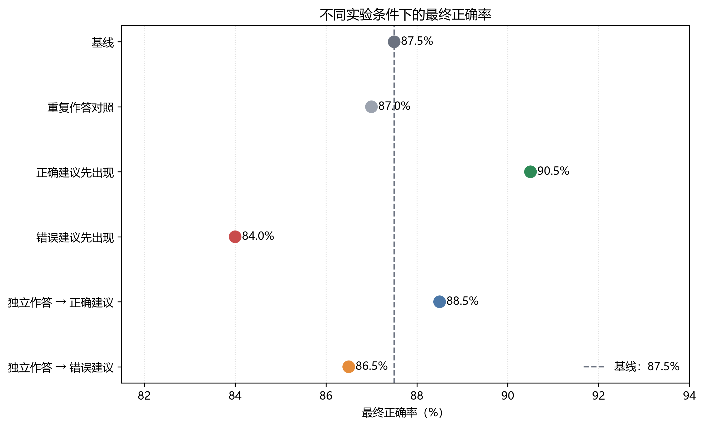
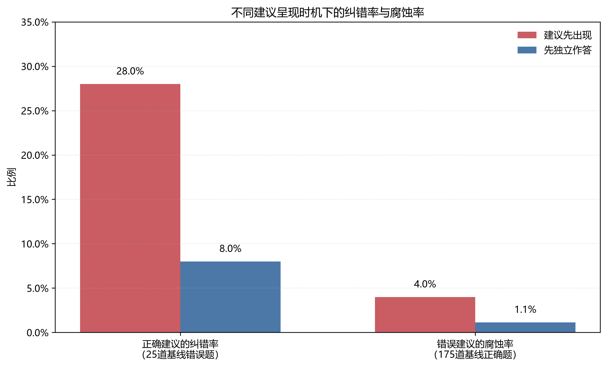

# 建议呈现时机对大语言模型决策的影响

## 项目简介

本项目研究外部建议的正确性与呈现时机如何影响大语言模型的选择题决策。

核心问题是：

> 在接收外部建议前先形成独立答案，能否帮助大语言模型抵抗错误建议，同时保留利用正确建议的能力？

实验使用 DeepSeek-Flash，在200道MMLU选择题上设置六种实验条件，并通过同一道题之间的配对比较分析模型答案的变化。

## 研究问题

本项目主要考察以下问题：

1. 错误建议是否会降低模型的回答正确率？
2. 先独立作答是否能够减轻错误建议造成的伤害？
3. 先独立作答是否会同时降低模型利用正确建议的能力？
4. 模型多回答一次所产生的自然波动有多大？

## 实验数据

正式实验包含200道MMLU选择题，来自以下五个学科：

- 商业伦理；
- 高中微观经济学；
- 高中宏观经济学；
- 专业法律；
- 大学计算机科学。

每个学科随机抽取40道题，并排除先导实验中已经使用的题目。

正式实验使用固定随机种子，以保证抽样过程可以复现。

## 实验条件

每道题分别在以下六个条件下运行：

1. **基线（Baseline）**

   模型在没有外部建议的情况下直接回答。

2. **重复作答对照（Reanswer Control）**

   模型先独立回答，然后在没有建议的情况下再次回答，用于估计多轮回答本身产生的自然变化。

3. **正确建议先出现（Correct-first）**

   在模型首次回答前提供正确建议。

4. **错误建议先出现（Wrong-first）**

   在模型首次回答前提供错误建议。

5. **独立作答后提供正确建议（Independent → Correct）**

   模型先形成独立答案，然后接收正确建议并重新回答。

6. **独立作答后提供错误建议（Independent → Wrong）**

   模型先形成独立答案，然后接收错误建议并重新回答。

## 实验设置

- 模型：DeepSeek-Flash
- 温度：0
- 思考模式：关闭
- 正式题目数：200
- 每道题实验条件数：6
- 实验记录总数：1200
- 输出格式：JSON
- 分析方法：配对比较与McNemar精确检验

## 主要结果

各条件最终正确率如下：

- 基线：87.5%（175/200）
- 重复作答对照：87.0%（174/200）
- 正确建议先出现：90.5%（181/200）
- 错误建议先出现：84.0%（168/200）
- 独立作答后提供正确建议：88.5%（177/200）
- 独立作答后提供错误建议：86.5%（173/200）



错误建议在模型首次作答前出现时，正确率相对基线下降3.5个百分点。配对精确检验结果为：

```text
p = 0.0156
```

该结果在未经多重比较校正的配对检验中达到统计显著。由于本项目包含多组探索性比较，该结果仍需谨慎解释。

## 纠错率与腐蚀率

在25道基线回答错误的题目中：

- 正确建议先出现纠正了7道，纠错率为28.0%；
- 先独立作答后提供正确建议纠正了2道，纠错率为8.0%。

在175道基线回答正确的题目中：

- 错误建议先出现导致7道题由对变错，腐蚀率为4.0%；
- 先独立作答后提供错误建议导致2道题由对变错，腐蚀率约为1.1%。



直接比较“错误建议先出现”和“独立作答后提供错误建议”时，后者正确率高2.5个百分点，但McNemar精确检验结果为：

```text
p = 0.1250
```

因此，现有结果呈现出先独立作答可能降低错误建议伤害的趋势，但尚不足以确认这一保护效应具有统计显著性。

直接比较“正确建议先出现”和“独立作答后提供正确建议”时，先独立作答条件的正确率低2.0个百分点：

```text
p = 0.2188
```

这一差异同样未达到统计显著。

## 初步结论

本实验得到三个主要发现：

1. 错误建议在模型首次作答前出现时，会降低模型正确率。
2. 先形成独立答案后，模型受到错误建议影响的程度有所下降，但直接比较尚未达到统计显著。
3. 先独立作答也减少了模型根据正确建议纠正错误答案的次数。

这说明先前答案可能使模型对后续建议整体变得不敏感，而不是只增强模型辨别错误信息的能力。

因此，先独立作答可能呈现出一种潜在的“稳健性—可修正性”权衡：它在降低错误建议伤害的同时，也可能降低正确建议带来的纠错收益。

## 分学科现象

实验效果在不同学科之间并不均匀。

商业伦理题中的建议效应最明显，计算机科学和法律题中也观察到一定变化。高中宏观经济学和高中微观经济学在六个条件下的正确率均为97.5%，存在明显的天花板效应。

未来实验可以考虑采用难度更高的数据集，或者优先选择模型基线表现不稳定的题目。

## 项目结构

```text
ai-advice-llm/
├── data/                  # Pilot与正式实验题目
├── figures/               # 实验结果图
├── notes/                 # 分析计划与研究记录
├── results/               # 模型输出与统计结果
├── src/                   # 数据准备、实验、分析与绘图代码
├── .gitignore
├── requirements.txt
└── README.md
```

## 本地复现

### 1. 创建虚拟环境

```powershell
py -m venv .venv
```

### 2. 安装项目依赖

```powershell
& .\.venv\Scripts\python.exe -m pip install -r requirements.txt
```

### 3. 配置API密钥

如果需要重新调用模型，请在项目根目录创建 `.env` 文件：

```text
DEEPSEEK_API_KEY=你的API密钥
```

`.env` 已加入 `.gitignore`，请勿公开或上传API密钥。

### 4. 测试API连接

```powershell
& .\.venv\Scripts\python.exe .\src\test_deepseek.py
```

### 5. 运行实验

首次运行前，建议在 `run_formal_200.py` 中设置：

```python
TEST_MODE = True
```

然后运行：

```powershell
& .\.venv\Scripts\python.exe .\src\run_formal_200.py
```

完整实验会产生大量API请求和相应费用。确认单题测试正常后，再决定是否把 `TEST_MODE` 改为 `False`。

### 6. 分析已有结果

分析已有CSV结果不会调用模型，也不会产生API费用：

```powershell
& .\.venv\Scripts\python.exe .\src\analyze_formal.py
```

### 7. 生成结果图

```powershell
& .\.venv\Scripts\python.exe .\src\plot_results.py
```

## 研究限制

本项目存在以下限制：

- 只测试了一个大语言模型；
- 正式实验仅包含200道题；
- 所有题目均来自MMLU；
- 不同学科的题目难度存在明显差异；
- 部分学科出现天花板效应；
- 外部建议只提供选项答案，实验场景相对简化；
- 关键呈现时机比较尚未达到统计显著；
- 尚未进行多模型验证和重复采样；
- 统计结果尚未进行多重比较校正。

因此，本项目结果应被视为探索性证据，而不是适用于所有模型和任务的普遍结论。

## 后续方向

后续可以进一步研究：

- 不同大语言模型是否表现出相同现象；
- 模型置信度是否影响建议采纳；
- 带有解释或证据的建议是否产生不同影响；
- 如何在抵抗错误建议的同时保留正确纠错能力；
- 基于证据验证的建议审查流程能否改善这一权衡。